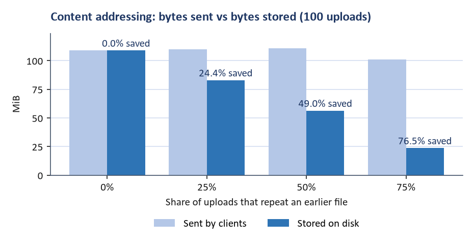
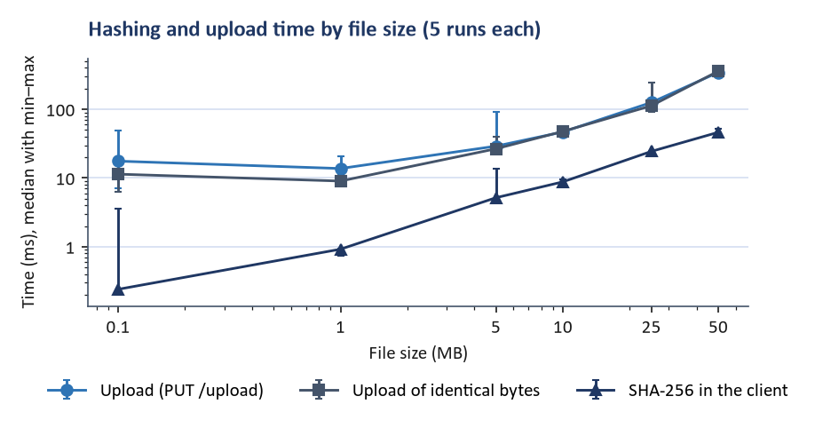
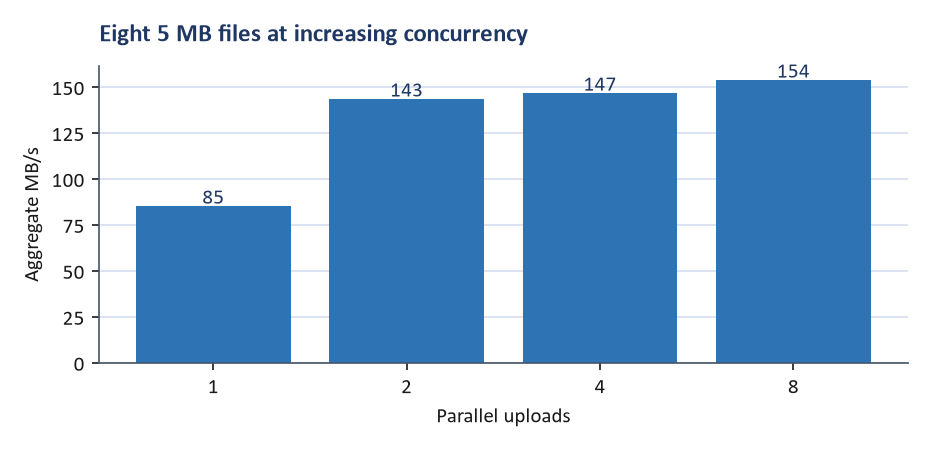
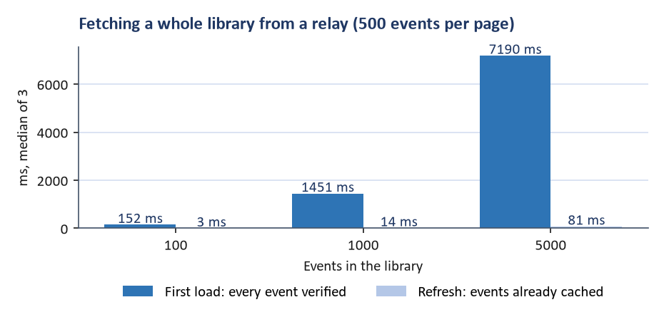
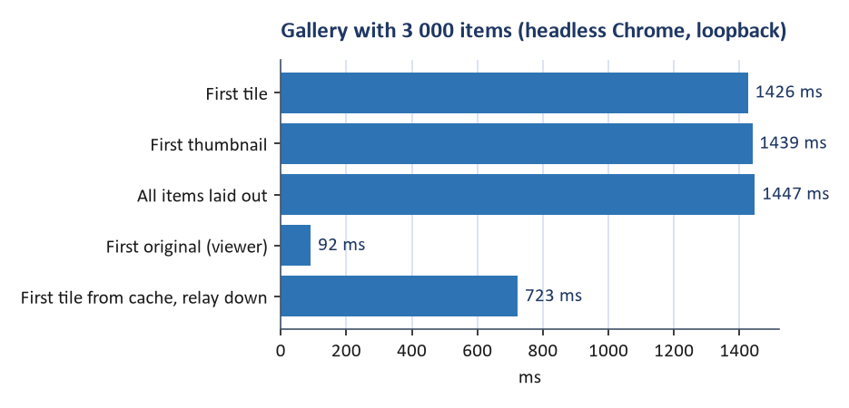

# Benchmark results

Generated by `scripts/report/build.ts` from the CSV files in `docs/benchmarks/`. Method, limits and the meaning of each measurement: `docs/BENCHMARK_METHODOLOGY.md`. All runs are on one machine over loopback; they show software cost, not network cost. The machine was short of free memory during the runs, so absolute times are noisy.

## Environment

| Item | Value |
| --- | --- |
| date | 2026-10-19T18:51:33.597Z |
| os | Windows_NT 10.0.26200 x64 |
| cpu | Intel(R) Core(TM) Ultra 9 275HX |
| logicalCores | 24 |
| totalMemoryMB | 15748 |
| node | v24.19.0 |
| go | go version go1.27.0 windows/amd64 |
| note | Client and server run on the same machine; network latency is loopback only. |

## Deduplication

| Repeat rate | Uploads | Sent (MiB) | Stored (MiB) | Blobs on disk | HTTP 201 | HTTP 200 | Saved |
| --- | --- | --- | --- | --- | --- | --- | --- |
| 0 % | 100 | 108.9 | 108.9 | 100 | 100 | 0 | 0.00 % |
| 25 % | 100 | 109.7 | 82.9 | 75 | 75 | 25 | 24.38 % |
| 50 % | 100 | 110.6 | 56.4 | 50 | 50 | 50 | 49.05 % |
| 75 % | 100 | 100.8 | 23.7 | 25 | 25 | 75 | 76.53 % |

## Upload (median of 5 runs per size)

| Size (MB) | SHA-256 (ms) | Token signing (ms) | Upload (ms) | Throughput (MB/s) | Identical re-upload (ms) | Failures |
| --- | --- | --- | --- | --- | --- | --- |
| 0.1 | 0.2 | 2.9 | 17.6 | 6 | 11.4 | 0 |
| 1 | 0.9 | 2.8 | 13.7 | 73 | 9.0 | 0 |
| 5 | 5.2 | 3.2 | 29.1 | 172 | 26.6 | 0 |
| 10 | 8.8 | 2.6 | 46.8 | 214 | 47.6 | 0 |
| 25 | 24.4 | 2.9 | 125.6 | 199 | 112.4 | 0 |
| 50 | 46.2 | 3.1 | 344.0 | 145 | 358.4 | 0 |

## Concurrent uploads

| Parallel uploads | Files | Total (ms) | Aggregate (MB/s) | Failures |
| --- | --- | --- | --- | --- |
| 1 | 8 | 470 | 85.1 | 0 |
| 2 | 8 | 279 | 143.4 | 0 |
| 4 | 8 | 273 | 146.6 | 0 |
| 8 | 8 | 260 | 153.7 | 0 |

## Relay

| Measurement | Detail | Value |
| --- | --- | --- |
| publish ack latency | median over 200 sequential events | 1.8 ms |
| publish ack latency | p95 | 2.32 ms |
| publish failures | of 200 | 0 count |
| query all events | 100 events, 500 per page, cold (every event verified) | 151.74 ms |
| query events returned | 100 events | 100 count |
| query all events | 100 events, 500 per page, warm (all cached) | 2.63 ms |
| query all events | 1000 events, 500 per page, cold (every event verified) | 1450.95 ms |
| query events returned | 1000 events | 1000 count |
| query all events | 1000 events, 500 per page, warm (all cached) | 13.5 ms |
| query all events | 5000 events, 500 per page, cold (every event verified) | 7189.8 ms |
| query events returned | 5000 events | 5000 count |
| query all events | 5000 events, 500 per page, warm (all cached) | 81.21 ms |
| drop detection | median of 5 | 15.28 ms |
| reconnect after drop | median of 5 (backoff 0.5–1 s first retry) | 679.36 ms |
| reconnect after drop | max of 5 | 968.46 ms |
| publish when relay down | outcome=unreachable | 2.06 ms |
| query when relay down | skipped=1 | 0.04 ms |
| publish when relay silent | outcome=timeout (timeout 6 s) | 4409.37 ms |

## Gallery, 3 000 items

| Measurement | Detail | Value |
| --- | --- | --- |
| first tile visible | click Open library → first tile in DOM | 1489 ms |
| first thumbnail decoded | click Open library → first thumbnail loaded | 1494 ms |
| all events rendered | 3000 events fetched in pages of 500 and laid out | 1503 ms |
| thumbnail requests initial | before any scrolling | 45 count |
| original requests initial | before opening any item | 0 count |
| dom tiles rendered | of 3000 items | 45 count |
| dom elements total | whole page | 362 count |
| grid height | full virtual height | 99964 px |
| dom tiles max while scrolling | of 3000 items | 75 count |
| scroll through library | viewport-sized steps; 2 frames each | 5006.2 ms |
| thumbnail requests scrolling | unique thumbnail URLs requested while scrolling the whole library | 2955 count |
| original requests scrolling | originals requested while scrolling | 0 count |
| first original ready | click tile → full-resolution image decoded | 71 ms |
| originals requested on open | one item opened | 2 count |
| cache first tile | reload; unlock; relay down → first tile | 613 ms |
| cache all items | reload; unlock; relay down → all 3000 items laid out | 631 ms |

