## Table of contents

# 1. Abstract

Sovereign Media Hub is a self-hosted photo and video library. The files live on a storage server the user runs; the user signs in with a Nostr key instead of a password; every file is stored under its SHA-256, so identical files occupy the disk once; and a small metadata index is kept on Nostr relays so that the library can be listed from any browser without sending the files through a third party.

The first review paper described this architecture and the mechanisms behind it. This report describes what was built. A prototype existed at the start of the term, but it did not work end to end: its upload authorisation used the wrong scheme for Blossom servers, its metadata publication called an API that no longer exists, its gallery downloaded every original file as a thumbnail, and it stored the private key in plain text in the browser. The storage server and the web client were rewritten around the same three-part design: a Go server implementing the Blossom specifications (BUD-01, 02, 06, 11 and 12), a TypeScript client that signs and hashes locally, and a relay layer with acknowledgements, reconnection, an offline cache and a retry queue for events no relay has accepted yet.

The result was exercised against a real server and relay and a real browser. The Go test suite has 42 tests, the client has 142 unit and integration tests, and 22 end-to-end scenarios run the built application in Chrome, including accessibility checks and layout checks at four viewport sizes. Measurements taken on one machine, over loopback, show that content addressing stores exactly one copy of repeated files, that a 50 MB upload completes in about a third of a second, and that a library of 3 000 items needs at most 75 tiles (about 300 elements) in the page at any moment. Fetching a 5 000-event library from a relay for the first time took 7.2 s, almost all of it signature verification; skipping events that are already cached brings a refresh to 81 ms (section 17).

Not done: the container and HTTPS configuration was written but could not be run (the development machine had no Docker and there was no domain), files are not end-to-end encrypted, and the comparison with centralised services that the first paper proposed was not carried out. Section 19 lists these limits.

# 2. Introduction and problem statement

Mainstream cloud photo services ask users to trade control for convenience. The provider holds the files, the user authenticates with a password that the provider must store in some form, and leaving the service means exporting a library that has been organised in a proprietary way. Self-hosted systems such as Nextcloud and PhotoPrism return the files to the user's hardware. They keep the account-and-password model, and a home server is normally reachable only from the local network.

The project asks two questions. First, can a storage server authenticate people without ever holding a secret that could be used to impersonate them? Second, can a library be indexed so that any device can browse it quickly, without the full-size files having to pass through a public service?

Nostr answers the first question: an identity is a key pair, and a request is authorised by a signature that the server can check against a public key. Blossom answers part of the second: files are addressed by their hash, which makes deduplication automatic and lets any server hold the same file under the same name. Relays answer the rest: they store short signed records that point to the files.

## 2.1 Starting point

The repository at the start of term contained a React 19 client and a Go storage server of about 1 000 lines in total, with no tests. An audit of that code (`docs/REPOSITORY_AUDIT.md`) found problems in four groups.

| Area | Findings in the prototype |
| --- | --- |
| Protocol | Blossom endpoints were authorised with NIP-98 (kind 27235) instead of BUD-11 (kind 24242); tokens were not bound to a blob; `PUT /upload` always answered 200; no range requests, so video seeking failed |
| Server | Files were served with a content type sniffed from their bytes and without `nosniff`, so an uploaded HTML file would be served as HTML; the hash path was checked only by length; any key could upload; duplicate detection was a check followed by a rename with no lock; the SQLite settings were written for another driver and were silently ignored (confirmed by a probe: `journal_mode=delete`, `foreign_keys=0`, `busy_timeout=0`) |
| Client | The private key was stored unencrypted in `localStorage`; "generate a temporary account" created a key the user never saw; relay publication used `pool.publish(...).on('ok')`, which does not exist in the installed nostr-tools; the "connected" indicator was always true; every thumbnail was the original file; images were re-encoded to WebP before upload, so the stored file was not the user's file |
| Deployment | The Caddy matcher combined `path_regexp` and `path` conditions that can never both be true; the Go image used a toolchain older than `go.mod` required; the server port was published beside the proxy |

## 2.2 Team and contributions

| Member | Registration number | Contribution |
| --- | --- | --- |
| Kushagra Yogendra Bansal | 25BDE0080 | Implementation, demonstration and documentation |
| Abhay Bhat | 25BDE0026 | Implementation and demonstration |
| Adwit Agarwal | 25BYB0116 | Documentation |
| Nilay Sengupta | 25BYB0255 | Documentation |

Guide: Dr. Sudha M, Professor. Repository: <https://github.com/GyroBullet/sovereign-media-hub>.

# 3. Objectives and requirements

The objectives follow the first paper and were narrowed to what could be demonstrated.

1. Authenticate with a key pair; the server must never receive the private key.
2. Store files under their SHA-256, computed by the server from the bytes it received.
3. Store identical bytes once, including under concurrent uploads.
4. Keep file bytes off relays; publish only metadata.
5. Show a gallery quickly from thumbnails and load an original only when asked.
6. Behave correctly when a relay or the storage server is unavailable, and say which one.
7. Be usable with a keyboard, at phone and desktop widths, and without fake status information.

Requirements derived from the objectives:

| Requirement | How it is checked |
| --- | --- |
| R1 Upload tokens follow BUD-11 and are rejected when forged, expired, mis-scoped or replayed | `backend/internal/auth/bud11_test.go` |
| R2 A client-supplied hash is never trusted | Server tests for mismatched `X-SHA-256`, token hash and truncated bodies |
| R3 One physical blob per distinct content | Concurrency test; deduplication benchmark |
| R4 No key material in storage, URLs or requests | Unit tests and a browser test that inspects storage |
| R5 Thumbnails first, originals on demand | Browser test counts requests |
| R6 Honest degraded states | Browser tests with the relay and the server stopped |
| R7 Keyboard, responsive, accessible | axe, keyboard and viewport tests |

# 4. Literature review and existing systems

**Centralised services.** Google Photos, iCloud and Dropbox combine storage, indexing and sharing under one account. They are convenient and reachable everywhere. The user must trust the provider with the files, and access depends on a password-based account.

**Self-hosted servers.** Nextcloud [10], ownCloud and PhotoPrism [10] keep files on hardware the user controls. They address the trust problem. They still use accounts and passwords, and remote access normally needs a port opened to the internet or a VPN.

**Content-addressed networks.** IPFS [5] names data by its hash and distributes it over a peer-to-peer network. The addressing idea is the same as in Blossom. IPFS adds a network layer that is hard to run reliably on a home device, and it does not by itself provide a private, owner-controlled library.

**Nostr and Blossom.** Nostr [1] defines signed events and relays that store and forward them. Blossom [2] defines a small HTTP interface for storing blobs under their SHA-256, with authorisation by a signed Nostr event. Neither defines a photo library. The combination used here is a design built from these parts, not an existing product; the contribution of the project is the integration and its evaluation.

Qualitative comparison, based on the descriptions above and not on tests of the other products:

| | Hosted service | Self-hosted server | IPFS | This project |
| --- | --- | --- | --- | --- |
| Files held by | Provider | User | Network peers | User's server |
| Sign-in | Account and password | Account and password | None | Signed requests |
| Deduplication | Provider-internal | Depends on product | By content hash | By content hash |
| Remote access | Built in | Port or VPN | Network | Reverse proxy and relays |
| Index | Provider | Server database | Not defined | Relays plus device cache |

# 5. Nostr, Blossom and content-addressed storage

## 5.1 Nostr events

A Nostr event is a JSON object with `id`, `pubkey`, `created_at`, `kind`, `tags`, `content` and `sig`. The id is the SHA-256 of a canonical serialisation of the other fields, and `sig` is a BIP-340 Schnorr signature [3] over the id with the key `pubkey`. A client sends `["EVENT", event]` to a relay and receives `["OK", id, true|false, reason]`. It asks for events with `["REQ", subscription, filter…]` and receives matching events followed by `["EOSE", subscription]`. Keys are exchanged as bech32 strings: `npub` for public keys, `nsec` for private keys and `ncryptsec` for keys encrypted with a passphrase (NIP-49) [1].

This project uses three event kinds:

| Kind | Specification | Use |
| --- | --- | --- |
| 1063 | NIP-94 file metadata | One event per file in the library |
| 5 | NIP-09 deletion | Asks relays to drop earlier events |
| 24242 | Blossom BUD-11 | Authorisation header for the storage server; never sent to relays |

NIP-98 (kind 27235) is a different, general mechanism for authenticating HTTP requests with a signed event. The prototype used it on Blossom routes. Blossom servers expect kind 24242, so the prototype could not have worked with any other Blossom client or server.

## 5.2 Blossom

The Blossom specifications used [2]:

* **BUD-01**: `GET` and `HEAD /<sha256>[.ext]`, permissive CORS, range requests.
* **BUD-02**: `PUT /upload` with the raw bytes; the server must hash exactly the bytes it receives and answer with a blob descriptor (`url`, `sha256`, `size`, `type`, `uploaded`), status 201 for a new blob and 200 for an existing one.
* **BUD-06**: `HEAD /upload` as an optional pre-flight with `X-SHA-256`, `X-Content-Type` and `X-Content-Length`.
* **BUD-11**: the authorisation token. A kind 24242 event with a `t` tag naming the verb, optional `x` tags naming the blob hashes it covers, a required `expiration` tag and optional `server` tags. The header is `Authorization: Nostr <base64url(event)>`.
* **BUD-12**: `GET /list/<pubkey>` with `cursor` and `limit`, and `DELETE /<sha256>`.

## 5.3 Content addressing

The name of a file is the SHA-256 of its bytes [4]. Two consequences matter here. Identical files have the same name, so a server that stores by name stores them once. And a client that knows a name can verify any copy it receives by hashing it, which the viewer's download button does.

# 6. Proposed methodology

The work followed the sequence below. Each step ended with a test or a run that could fail.

1. **Audit.** Read and build the prototype, probe suspected defects, record the baseline (`docs/REPOSITORY_AUDIT.md`).
2. **Specification check.** Read the BUD and NIP texts used, to avoid relying on memory of protocol details. This is how the NIP-98 versus BUD-11 mismatch and the `server` and `x` token rules were confirmed.
3. **Server first.** Rewrite the storage server against the specifications with tests, because the client's behaviour depends on it.
4. **Protocol libraries.** Keys, events, token creation, relay manager, cache and outbox, each with unit tests; an integration suite that drives them against the real server.
5. **Interface.** Design tokens, components and screens built on those libraries, with every control wired to real behaviour.
6. **Browser tests.** Drive the built application in Chrome, take screenshots, run accessibility checks, fix what they find.
7. **Measurement.** Scripts that produce CSV files; tables and charts are generated from the CSV files.
8. **Report.** This document, with tables generated from the measurement files.

Defects found by this process after the rewrite are listed in `docs/SECURITY_REVIEW.md` and in section 16.

# 7. System architecture and diagrams

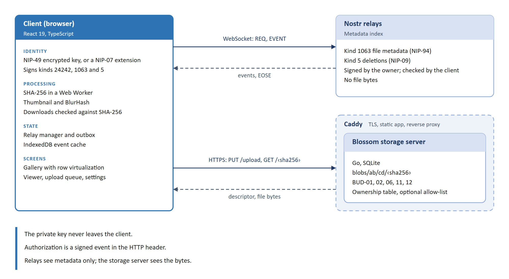

The client talks to relays over WebSocket and to the storage server over HTTP. A reverse proxy serves the application and forwards storage requests so that browsers see a single origin. Relays never receive file bytes. The storage server never receives the private key, only signed tokens.

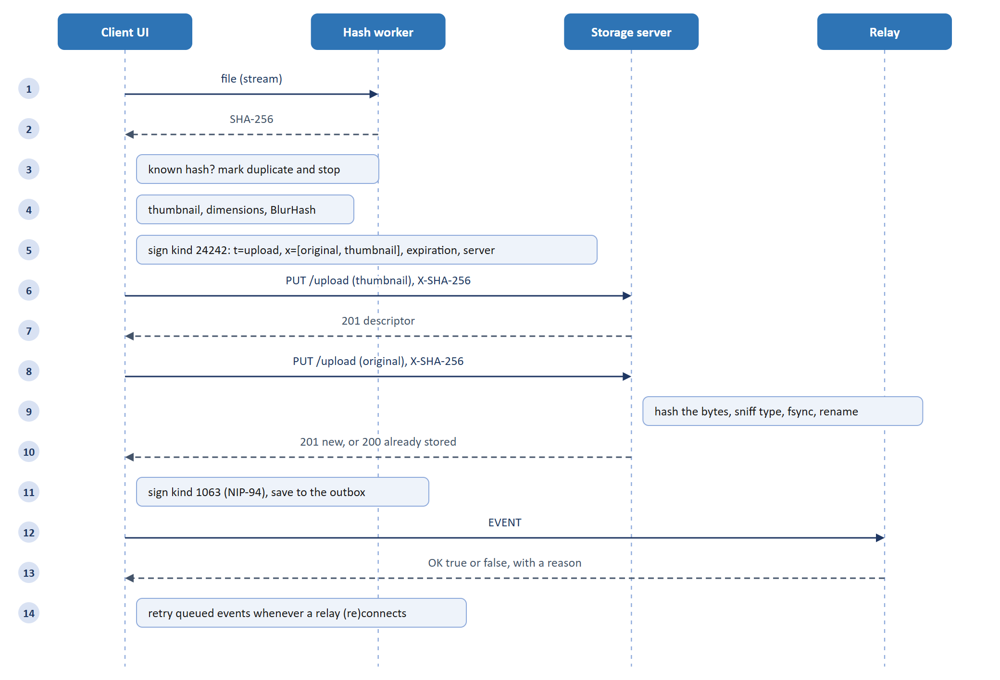

The order in Figure 2 is deliberate. The hash is known before the upload starts because the token carries it. The thumbnail is uploaded first because it is small and cheap to repeat. The metadata event is signed and stored in the local outbox before it is sent, so a relay failure cannot lose it.

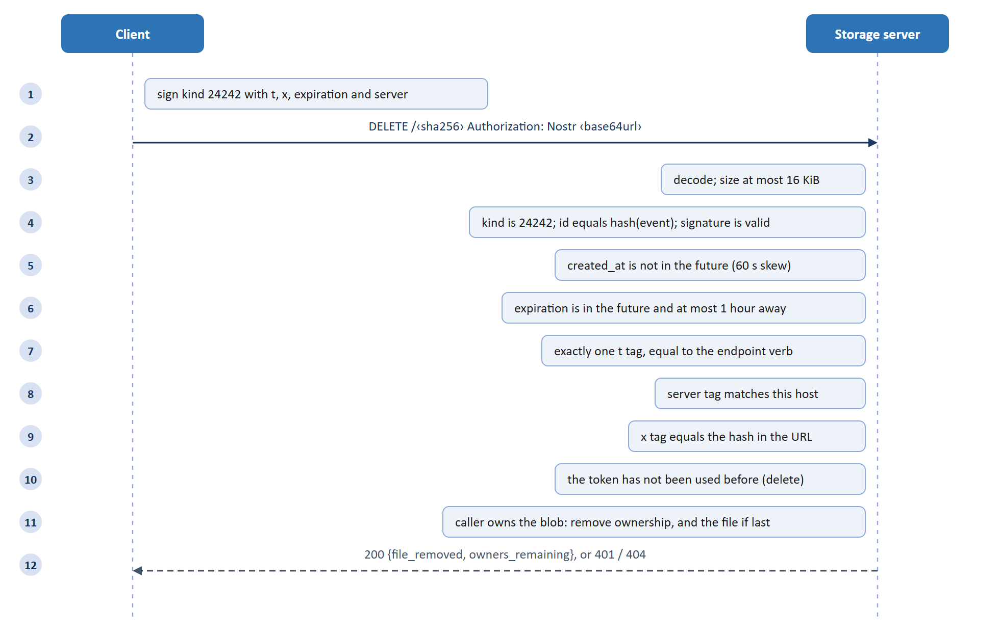

## 7.1 Where state lives

| State | Location |
| --- | --- |
| Private key | NIP-49 ciphertext in `localStorage`; plaintext only in memory while unlocked; or held by a NIP-07 extension |
| Settings | `localStorage` |
| Metadata events | IndexedDB, up to 20 000, for offline browsing |
| Unsent events | IndexedDB outbox, with a list of relays that have accepted each |
| File bytes | Server filesystem, `blobs/ab/cd/<sha256>` |
| Ownership, sizes, types | Server SQLite database |

# 8. Technology stack actually used

| Layer | Technology | Notes |
| --- | --- | --- |
| Client | React 19, TypeScript 7, Vite 8, react-router 7 | State in small `useSyncExternalStore` stores; no UI framework |
| Protocol libraries | nostr-tools 2.25 (keys, NIP-19, NIP-49, relay connections, event signing), @noble/hashes (streaming SHA-256), blurhash | |
| Icons and fonts | lucide-react; IBM Plex Sans and Mono, served from the application | No third-party font requests |
| Server | Go 1.24 (`net/http`), `modernc.org/sqlite` (pure Go), `go-nostr` for event verification | One static binary |
| Relay for development and tests | Node and `ws`; `frontend/tools/dev-relay` | Not for production |
| Proxy | Caddy 2.8 | Static files, reverse proxy, TLS |
| Tests | Go `testing`; Vitest 5; Playwright with the installed Chrome; axe-core | |
| Tooling | Prettier, oxlint, `tsc` | |

The Go race detector (`go test -race`) could not be run on the development machine, which has only a 32-bit C compiler. It is configured in the CI workflow (`.github/workflows/ci.yml`) for Linux.

# 9. Detailed implementation

## 9.1 Storage server

The server is split into `config`, `auth`, `media`, `store`, `db` and `server` packages.

**Upload path.** `PUT /upload` first checks the token and the allow-list, then streams the request body into a temporary file in `tmp/` while computing SHA-256 and reading the first 32 bytes to identify the file type against an allow-list (JPEG, PNG, GIF, WebP, AVIF, MP4, MOV, WebM). Anything else is rejected before the rest of the body is stored. After the stream ends the server calls `fsync`, compares the computed hash with `X-SHA-256` (409 if different) and with the token's `x` tags (401 if the token does not cover these bytes), and then, under a lock chosen by the first byte of the hash, renames the file to `blobs/ab/cd/<sha256>` unless it already exists, and records ownership in SQLite. The response is 201 for a new file and 200 for an existing one.

**Serving.** Responses use the type identified from the bytes, `X-Content-Type-Options: nosniff`, `Content-Security-Policy: default-src 'none'; sandbox`, an immutable cache header and an `ETag` equal to the hash. `http.ServeContent` provides range requests.

**Deletion and ownership.** Each key that uploads a blob becomes an owner. `DELETE` removes the caller's ownership and removes the file only when no owner remains. The same lock serialises this with uploads, so an upload cannot deduplicate against a file that a concurrent delete is about to remove.

**Startup.** The temporary directory is emptied. The database is compared with the files: rows without a file are dropped; files without a row are left in place and counted in the log, because a restored older database backup would otherwise cause data loss.

**Limits.** Maximum file size (declared and streamed), a per-client token bucket on writes, `ReadHeaderTimeout`, and a read deadline renewed on every read during uploads so that stalled clients are dropped without a total-time limit that would cut off large uploads. An optional allow-list (`ALLOWED_PUBKEYS`) restricts who may upload.

**SQLite.** Write-ahead logging, foreign keys and a busy timeout, set with the `_pragma` syntax of the pure-Go driver. A test reads the three settings back.

## 9.2 Client libraries

`lib/nostr/keys.ts` wraps key generation, bech32 encodings, NIP-49 encryption and event signing. Two behaviours of the underlying libraries needed care. `finalizeEvent` writes `id`, `pubkey` and `sig` onto the object it receives, so two signatures of the same template object returned one shared object; templates are now copied first. `verifyEvent` caches its result in a hidden property that survives object spread, so a copied and tampered event could still verify; events are rebuilt from their seven fields before verification.

`lib/blossom/client.ts` builds BUD-11 tokens (base64url, `t`, `x`, `expiration`, `server`), uploads with `XMLHttpRequest` for real byte-level progress, and implements `HEAD`, `DELETE` and cursor-based `list`. An upload error distinguishes "could not reach the server" (no bytes were sent) from "connection lost during the upload".

`lib/nostr/events.ts` builds and parses NIP-94 and NIP-09 events and validates everything read from relays (section 12).

`lib/media` holds file-type detection that mirrors the server, thumbnail and BlurHash generation, the justified-row layout and search and sort.

## 9.3 Stores

`identity` manages the key lifecycle. `library` merges cached and relay events, tracks the outbox and exposes one entry per distinct file. `uploads` runs a queue with two concurrent uploads through the stages check, hash, preview, upload and publish, with cancel and retry. `connections` and the relay manager provide measured status for the storage server and each relay. `settings` holds the user's choices and the deployment defaults read from `/config.json`.

# 10. Identity and authentication

**Key handling.** A new key is generated in the browser. The user chooses a passphrase and the key is encrypted with NIP-49 (scrypt, cost 2^16) before it is saved, or the user chooses session-only mode and nothing is saved. An existing key can be imported as `nsec`, hex or an encrypted backup, or the user can sign in with a NIP-07 extension, in which case the application never sees the key. After a reload the stored identity is locked until the passphrase is entered; a wrong passphrase leaves the stored identity untouched.

**Backup.** The setup flow requires the user to download the encrypted backup or reveal the `nsec` and then tick a box, or to confirm in a dialog that they are skipping it. The secret is not in the page until "Show secret key" is pressed.

**Tokens.** For each upload, one token is signed with `x` tags for the original and its thumbnail, a five- to ten-minute expiry and the server's host name. The server rejects tokens with forged ids or signatures, the wrong kind or verb, a missing, past or too distant expiry, a future `created_at` beyond 60 s, a different `server`, or an `x` that does not match the blob. Delete tokens are single use. Section 14 describes what this does and does not prevent.

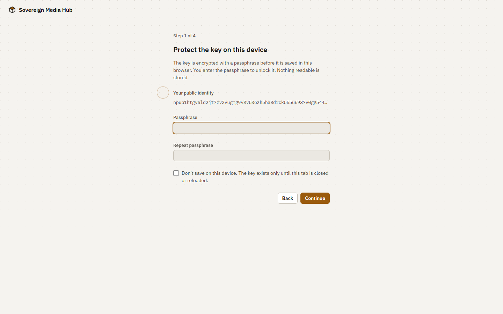

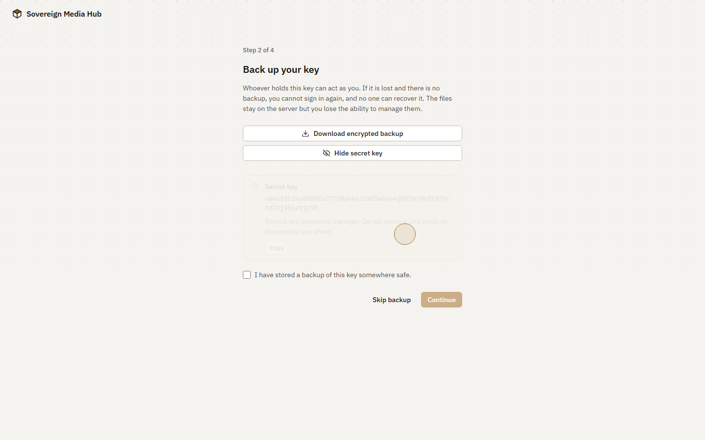

**Checked in a browser.** After setup, `localStorage` holds exactly four fields (`v`, `pubkey`, `source`, `ncryptsec`), `sessionStorage` is empty, and no string starting with `nsec1` appears in storage or the address.

# 11. Upload, hashing and deduplication

**Hashing.** Files up to 32 MiB use the browser's native SHA-256. Larger files are streamed through a Web Worker with an incremental hash so that a large video is neither held in memory nor blocks the page. In the loopback benchmark the native hash of a 50 MB buffer took 46 ms, against 344 ms for the upload (section 17).

**Previews.** The browser decodes the file, applies orientation, scales it to at most 512 px on the long side, encodes WebP (or JPEG where the browser cannot encode WebP) and computes a BlurHash. Videos use a captured frame; files recorded in the browser that report an infinite duration use their first frame. The original is never re-encoded, so its hash is that of the user's file.

**Duplicates.** If the library already holds the hash, the file is reported as already present and nothing is sent. If the server already holds the bytes but the library does not know them (for example after a lost event), the upload returns 200, the panel says the server already had them, and a metadata event is still published.

**Server-side.** The server hashes the bytes itself. The tests cover identical files, different files, a truncated body, a hash header that disagrees with the body, a token for a different blob, oversize files (declared and chunked), 24 concurrent uploads of one file (exactly one 201, 23 × 200, one file on disk, no temporary files), interrupted uploads, restart persistence and corruption detection by `-scrub`.

# 12. Relay indexing and synchronisation

**Events.** Section 5 and `docs/EVENT_SCHEMA.md` define the tags. One extension tag, `smh-taken`, carries the file's modification time; a second, `smh-duration`, carries video length. Both are prefixed so that other clients ignore them.

**Validation.** Events from relays are untrusted. An event enters the library only if the relay layer verified its signature, its `pubkey` is the owner, its kind is 1063, `url` and `thumb` are http or https, the hash and MIME type are well formed. Optional tags that fail their format are ignored and the event is kept. Deletions count only when signed by the owner.

**Relay manager.** Each relay has a state (`connecting`, `connected`, `disconnected`, `error`), the reason for the last failure, the measured connection time and the time of the last query. A closed connection is retried with exponential back-off and jitter. Publication returns one outcome per relay: accepted, rejected with the relay's message, timed out, or unreachable. Queries merge relays, drop duplicates and page backwards with `until` for relays that cap `limit`.

**Outbox and cache.** Every signed event is stored in the outbox before it is published and removed when every configured relay has accepted it; the record keeps which relays already have it, so a relay that was down receives the event later without the others receiving it again. Verified events are cached in IndexedDB. On start the library shows the cache immediately and then refreshes from the relays; the banner says when it is showing only the cache and how old it is.

**Deletion.** The kind 5 event is published first, then the files are deleted from the server. If the server step fails the file remains under the user's key and is listed in Settings under "not in the library", where it can be deleted. The reverse order could leave a library entry whose file is gone.

**Cost of verification.** A cold fetch of a large library is dominated by signature verification (section 17). Events the client already holds are skipped before they are parsed or verified, and a copy of an event received from a second relay is also skipped. Paging uses the count of events the relay sent, not the count returned to the caller, so skipping does not end paging early.

# 13. Frontend UI/UX design and workflows

## 13.1 Direction

The interface is meant to read as a tool for a personal library, not as a product page. The photographs supply the colour. Surfaces are warm greys, there is one accent colour (ochre), icons are one consistent line set, and text is IBM Plex Sans with IBM Plex Mono for hashes and keys. There are no gradients, glass effects, decorative shapes or invented figures. Corner radii come from three values. Shadows are used only on pop-ups and dialogs. Dark is the default for the library; light follows the system setting or the user's choice.

The design tokens (`src/styles/tokens.css`) define backgrounds, text and border roles, interaction colours, status colours, the type scale, a 4 px spacing scale, radii, control heights, motion durations and the focus ring. Every component reads those variables, and the light and dark themes redefine them.

## 13.2 Screens

**First run.** One column: the product in two sentences, and three choices (create, use an existing key, use an extension). The extension option is disabled with a reason when no extension is present. Setup continues with the passphrase, the backup, and the storage and relay addresses, each with a real connection test.

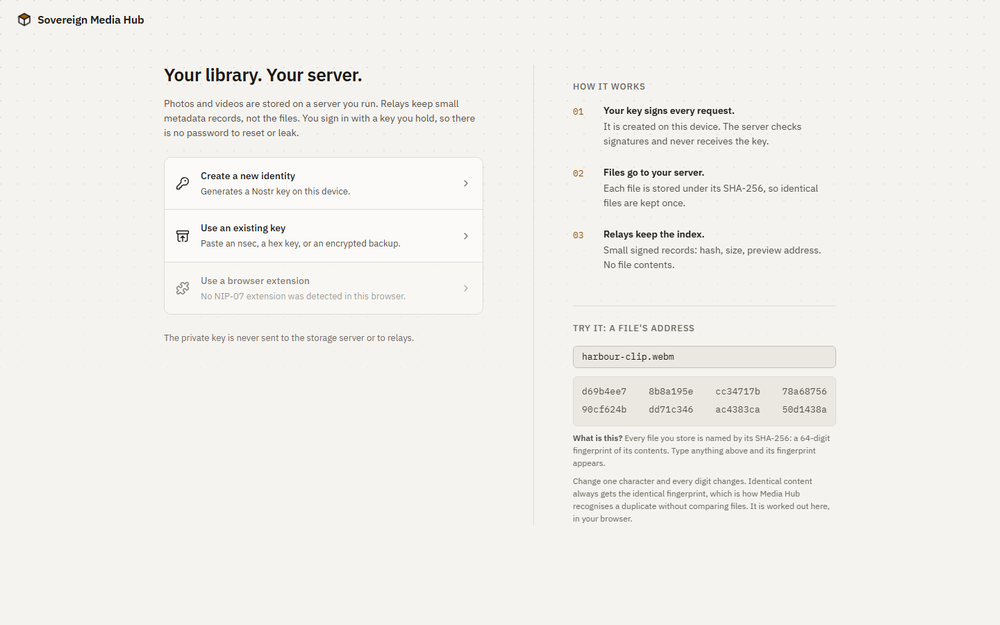

**Library.** A compact sidebar (an icon rail below 1100 px, a tab bar below 720 px), a sticky toolbar with search, type filter, sort, selection and upload, and the grid. Rows are justified: every tile keeps its aspect ratio from the `dim` tag, full rows span the width, and the last row is not stretched. Because positions come from metadata, nothing moves when images load. Only rows near the viewport are in the page. BlurHash fills a tile until its thumbnail arrives.

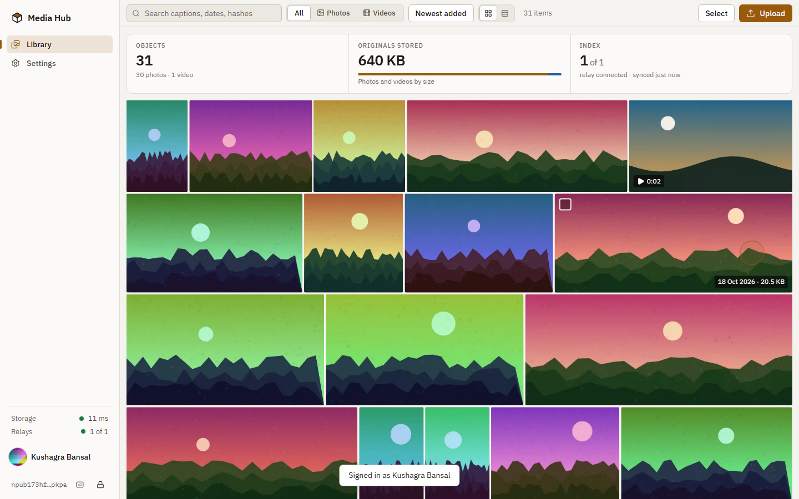

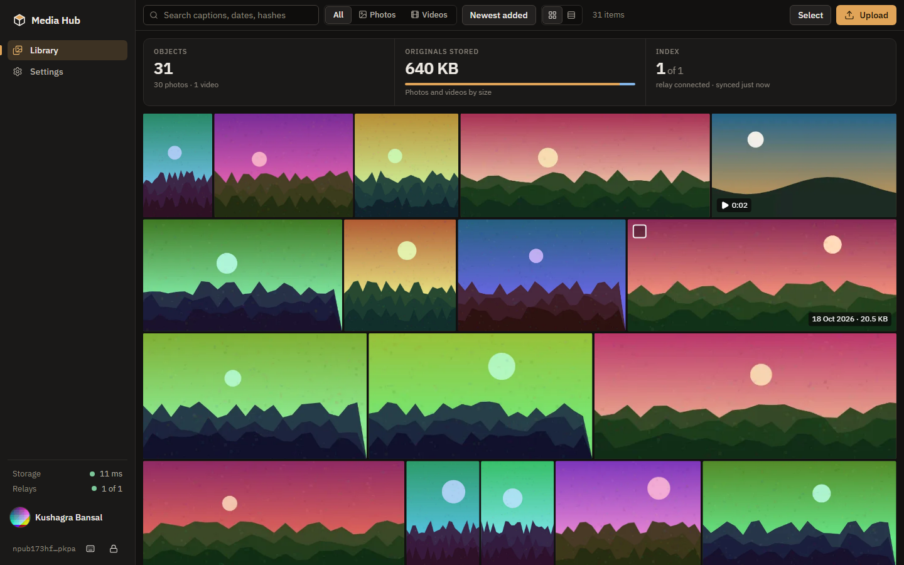

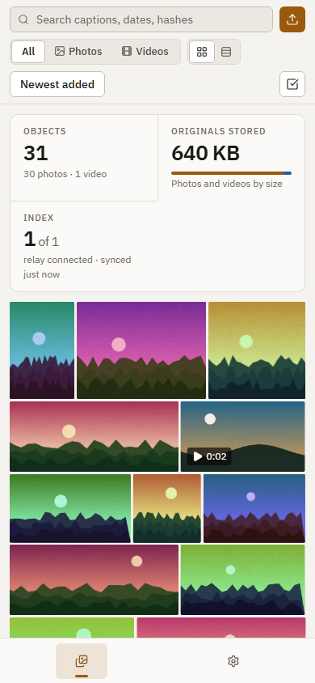

**Selection.** The selection bar offers select all, download (each file is verified against its hash before saving) and delete with a confirmation that states what will and will not be removed.

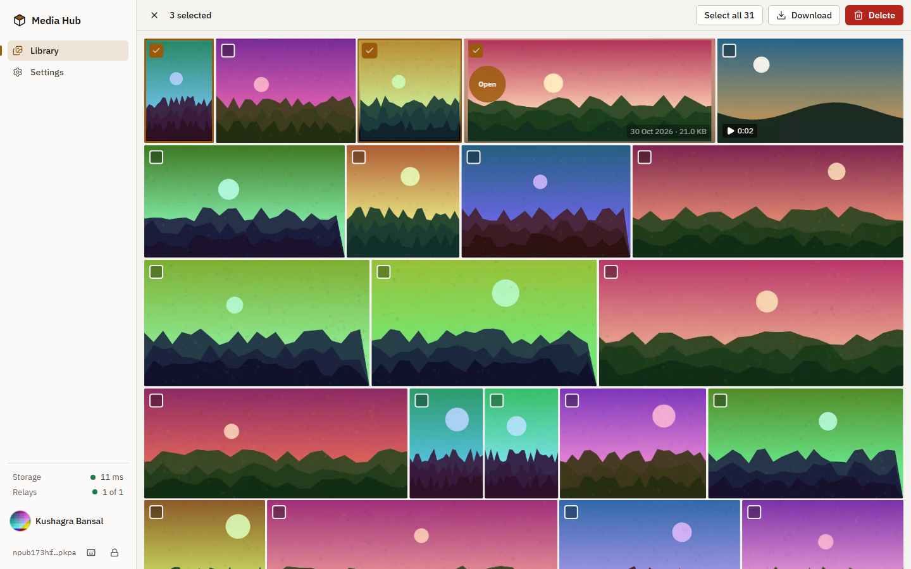

**Viewer.** A full-window viewer reachable by address (`/m/<sha256>`). Arrow keys move between items, `i` toggles details, `+`, `-` and `0` zoom, Escape closes and returns focus to the tile. Details open over the image on the right (below it on phones) and show type, size, dimensions, dates, the storing server, the hash, the event id and the URL, each with a copy button, and a note that file URLs are not secret. The original loads over the thumbnail; if it fails, the viewer probes the server and says whether the file is missing, the server is unreachable or the browser cannot display it, then offers a retry.

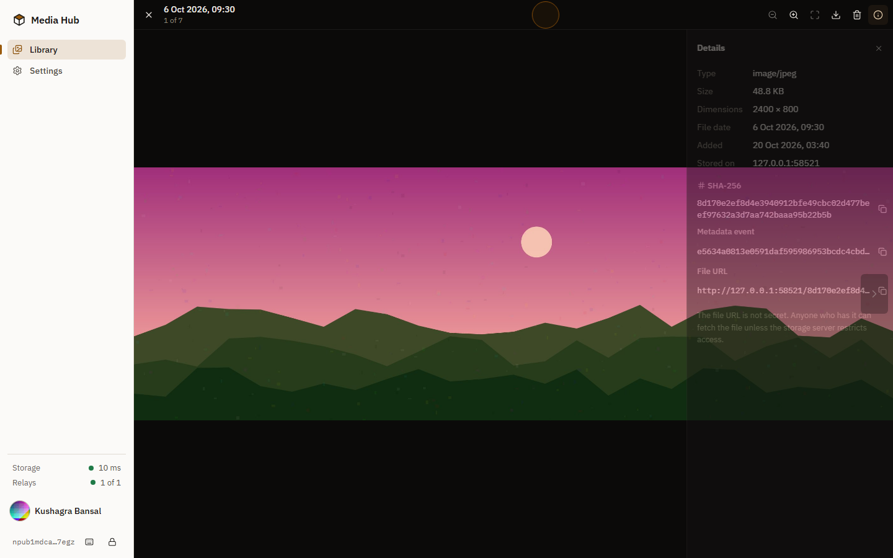

**Uploads.** A panel lists each file with its real stage: hashing (bytes hashed), uploading (bytes sent), publishing, and the result: added with the number of relays that accepted the event, already in the library, or failed with a reason and a retry. It folds away a few seconds after a clean batch and stays open on failures.

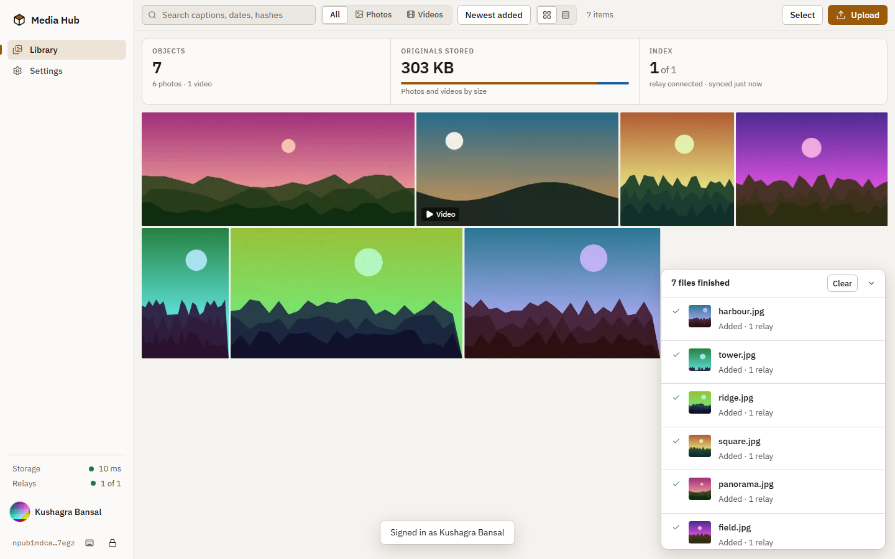

**Settings.** Identity (public key, custody, backup, lock, removal), connections with measured status and a per-relay reason, storage measured from the server with a list of files not in the library, theme, cache size, a plain statement of what each party can see, and troubleshooting based on failures observed during development.

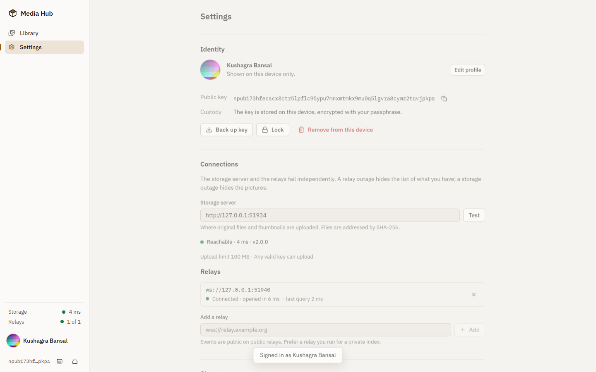

## 13.3 Degraded states

The storage server and the relays fail separately and the interface says which. Status is never a single "online" badge.

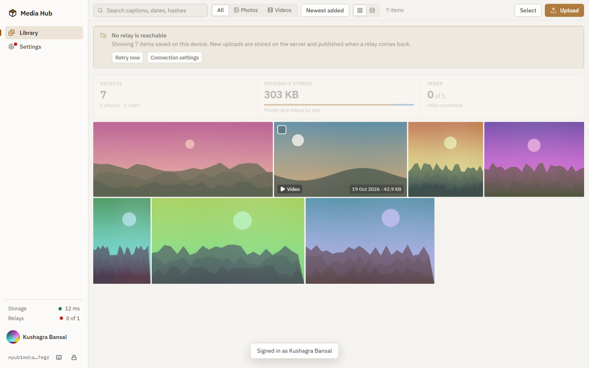

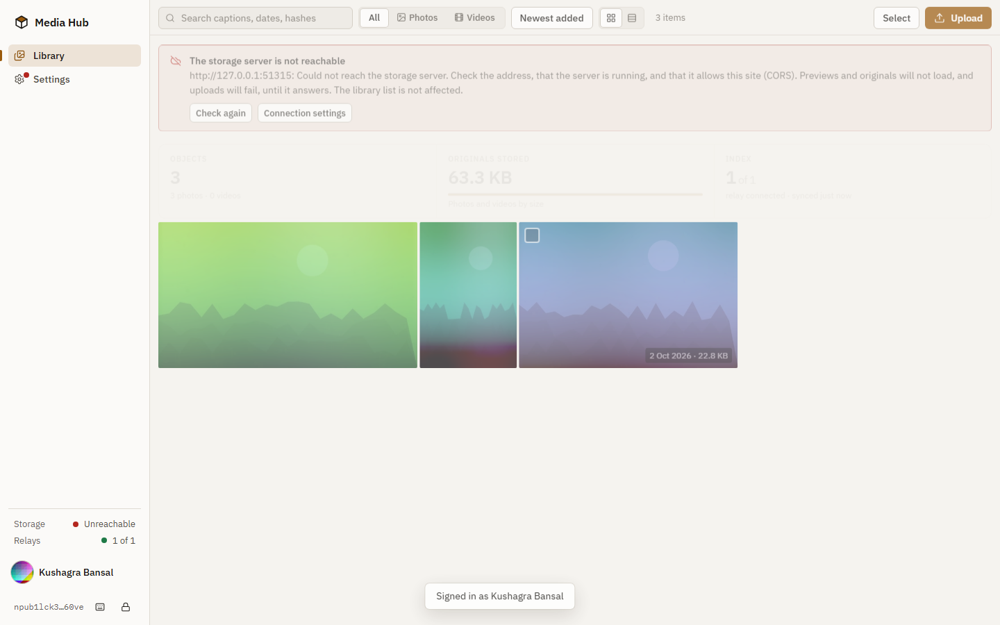

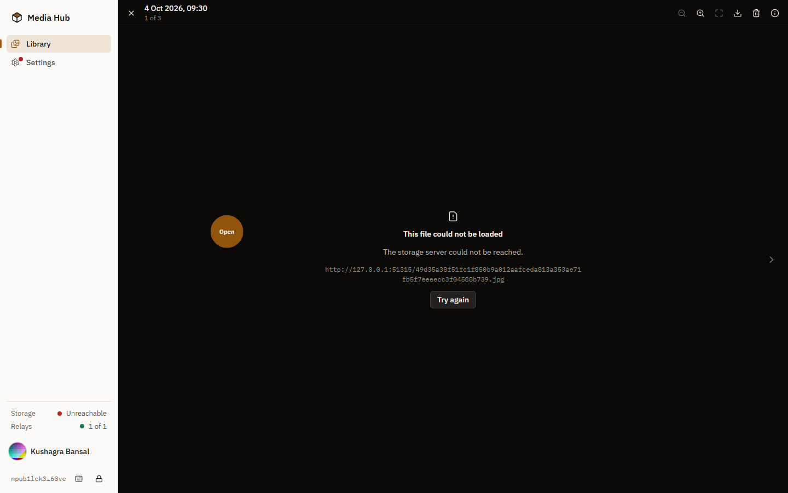

## 13.4 Accessibility and responsiveness

* Semantic landmarks, a skip link, a single tab stop for the grid with arrow-key navigation, visible focus rings, names for every icon button, and `aria-live` for toasts and the upload panel.
* Dialogs use `<dialog>` (focus trap, Escape). The viewer has its own focus trap and restores focus on close.
* `prefers-reduced-motion` removes transitions; motion elsewhere is limited to a 160 ms fade of images and dialogs.
* Touch targets grow to 44 px on coarse pointers.
* axe-core (WCAG 2.0 and 2.1, A and AA) reports no violations on the welcome, protect-key, library (light and dark), viewer, settings and unlock screens. An earlier run reported one real defect, a video tile whose accessible name omitted its visible "Video" text; it was fixed.
* No horizontal overflow at 1920, 1440, 820 and 390 px, and none at ten widths from 1280 down to 360 px; tiles stay inside the viewport.

## 13.5 Design review and refinements

After the first complete version the interface was reviewed screen by screen from four points of view. The findings, and what was changed, are listed here because they explain several choices that are visible in the final screenshots.

| Reviewer | Finding on the first version | Change made |
| --- | --- | --- |
| Visual design | The logo was a generic viewfinder and said nothing about the product. The first screen was clean but showed no picture of the one idea that matters: files are named by their content. | A new mark: a block seen from above, whose lit top face is the address and whose lower faces are the content. It is drawn in on the first-run and unlock screens. The first-run screen gained an interactive address demonstration (below). |
| Interaction design | Changing screens was abrupt. Opening a photo cut straight to a full-screen viewer, so the person lost track of which photo they had chosen. | Opening a photo is a shared-element transition: the thumbnail grows into the viewer (View Transitions API). Screens settle in with a short staggered rise. Everything is switched off when the system asks for reduced motion, and browsers without the API simply change screen. |
| Product | The library looked like a photo grid only. A person who wants to know what is stored, how large it is and what address names it had no place to look. | A totals strip above the library (objects, bytes of originals with a photo and video split, relays connected and last sync) and a second layout, the ledger: one row per stored object with its SHA-256 address, size, dimensions, time added and the id of the event that lists it. |
| Accessibility and performance | A custom pointer must not replace the real one, and a table of thousands of rows must not slow the page. | The cursor ring is decoration only: it is hidden from assistive technology, ignores the pointer, and exists only for a mouse and without reduced-motion. The native cursor is kept, restyled. The ledger shows 100 rows at a time and says how many remain. Axe reports no violations on the ledger at laptop, tablet and phone width. |

**Address demonstration.** The first-run screen has a text box and, under it, the SHA-256 of whatever is typed, computed in the browser with the same function that names uploaded files. Characters that change on each keystroke flash. A test checks it against the standard test vector for the text "abc" (`ba7816bf 8f01cfea 414140de 5dae2223 b00361a3 96177a9c b410ff61 f20015ad`). It is the quickest way to show that identical content has one address and that any change produces a different one.

**Cursor.** The pointer is a small ochre arrow with a dark outline, and a dot over clickable things. A soft ring follows it with a short delay. It widens over buttons and links, becomes a labelled disc ("Open" over a photo, "Play" over a video), becomes a thin bar over text fields, and shrinks while the button is pressed.

**Totals are measured, not estimated.** Every figure in the strip is summed from the metadata events the library already holds; when an event has no size the strip says how many items are missing one instead of guessing. The "Saved by addressing" figure appears only after a duplicate upload has actually been skipped in the current session, and shows the bytes of the skipped files.

**Name and photo.** After the key is protected and backed up, setup asks for a name and an optional photo ("What should we call you?"). They are saved in this browser beside the key, keyed by the public key, and are never sent to the storage server or to a relay: publishing them as a Nostr profile event would make them public, which a private library should not do by default. The photo is cropped to the centre and scaled to 160 px in the browser and kept as a small JPEG; the original is not stored. The name appears in the sidebar with the photo, on the unlock screen ("Welcome back"), and in a short "Signed in as ..." message each time the library opens. Settings has an Edit profile control, and removing the identity from the device removes the profile with it.

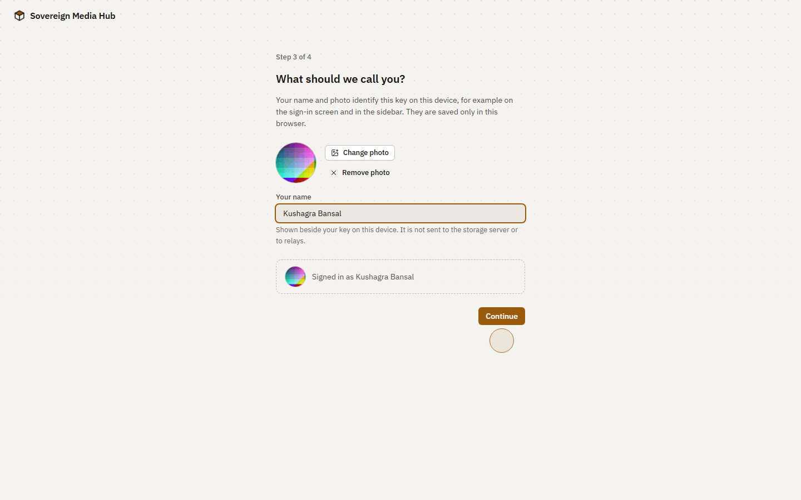

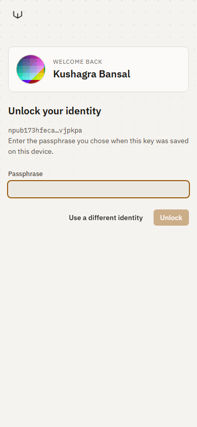


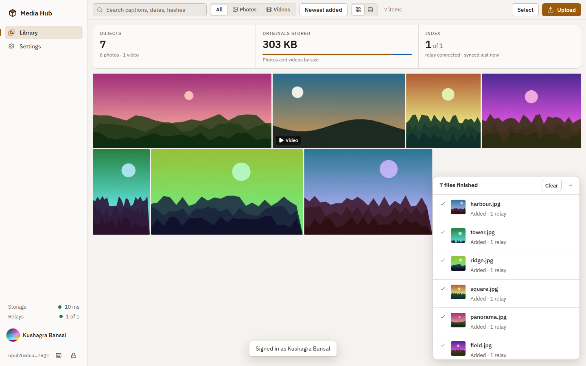

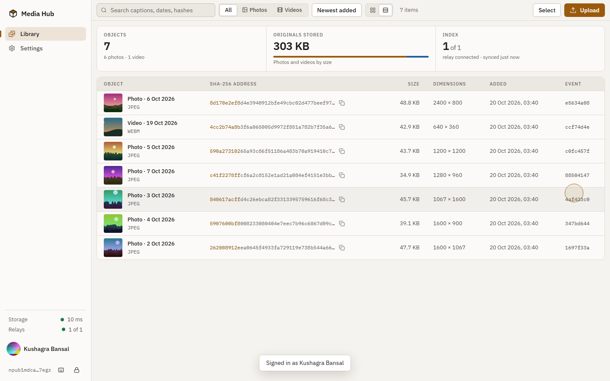

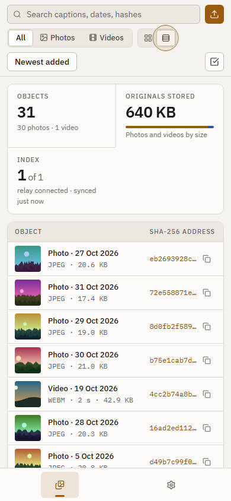

# 14. Security analysis and threat model

`docs/THREAT_MODEL.md` lists 21 threats with mitigations and residual risk; `docs/SECURITY_REVIEW.md` records the review. The main points:

| Threat | Control | Residual risk |
| --- | --- | --- |
| Key theft from the browser | NIP-49 ciphertext only; plaintext in memory while unlocked | Weak passphrase; script injection while unlocked |
| Forged or replayed tokens | Signature and id check; scope by verb, hash, server and expiry; single-use delete tokens | A captured upload token can re-upload the same blob until it expires |
| Stored XSS through uploads | Allow-list by magic bytes; sniffed type; `nosniff`; sandbox CSP | A polyglot is served only as its image type |
| Path traversal | 64 lowercase hex characters; paths derived from the hash | None known |
| Storage abuse | Allow-list, size limit, rate limit, timeouts | An empty allow-list accepts any key |
| Hostile relay | Signatures verified; owner and kind checked; URLs restricted to http and https | A relay can hide or delay events |
| Metadata exposure | Stated in the interface; user can run their own relay | Public relays expose hashes, key and times |
| Operator access | Not mitigated | The server operator can read all files |

Defects found during the review of the new code, not only in the prototype: `go-nostr`'s signature check does not compare the event's `id` field with the recomputed hash (a token with a forged `id` would have passed; fixed and tested), and the two nostr-tools behaviours described in section 9.2.

# 15. Docker and deployment

`docker-compose.yml` defines two services. `server` is built from `backend/Dockerfile` (Go build stage, Alpine runtime, non-root user, health check using the binary's `-healthcheck` flag, read-only root file system, no capabilities, no published port). `web` is built from `frontend/Dockerfile` (Node build stage, Caddy runtime) and serves the application, proxies `/upload`, `/list/*`, `/health`, `/info` and `/<sha256>[.ext]` to `server`, writes `/config.json` from environment variables, and sets a restrictive content security policy. `SITE_ADDRESS` set to a domain name enables Caddy's automatic HTTPS. The backup procedure is the `media` volume; `server -scrub` re-verifies every blob.

**Status.** These files were written and statically reviewed. They were not run. The development machine had no Docker, and HTTPS needs a public domain and open ports. The restart behaviour of the server (same data directory, new process) is covered by the automated tests; container-level persistence is not. The CI workflow runs `docker compose config` and `docker compose build` where Docker exists. See `docs/DEPLOYMENT.md`.

# 16. Testing and validation

| Suite | Count | What it covers |
| --- | --- | --- |
| Go (`go test ./...`) | 42 tests plus table-driven cases | Token validation, storage and deduplication, concurrency, limits, paths, restart, reconcile, pragmas |
| Vitest, libraries and stores | 142 tests in 12 files | Keys and NIP-49, events and validation, token format, relay manager against a local relay, layout, search, file-type detection, identity lifecycle, and an integration suite against the real Go server |
| Playwright, in Chrome | 22 scenarios | First run to deletion; verified download; duplicates; relay outage; server outage; keyboard; accessibility; responsive layout (including the ledger); address demonstration; key storage; 3 000-item gallery |

The integration suite starts the Go server and a relay, uploads real PNG files, checks the event the relay received, retrieves the bytes and compares hashes, uploads the same file from a second index and checks that the server still has two files (original and thumbnail), makes a relay refuse an event and checks that it is queued and delivered later, stops the relay and checks that the cached library opens, restarts the server and checks the bytes, and deletes through both layers.

**Failures found by the tests and fixed.** A selection of defects that the tests exposed in the new code: a relay query that reported every relay as timed out because closing a subscription fired its close handler before the end-of-stored-events handler resolved; cached events counted twice for paging; a test double that shared one signed object between two signatures; the video tile name mismatch; an upload error message that said the connection had been "lost during the upload" when the server had never been reachable; a stop routine for the test server that waited forever for a process that had already exited; a nostr-tools relay timeout reported as a rejection instead of a timeout; and, found only by the 3 000-item browser run, a library that stayed empty when the relays were changed after it had started (the existing events were never re-requested). The library now refreshes whenever a relay connects, and a regression test covers it.

**Not tested.** Containers and HTTPS; `go test -race`; Firefox and Safari; MP4 and MOV previews; a real NIP-07 extension; public relays; files above 50 MB. See `docs/TESTING.md`.

# 17. Performance methodology and results

## 17.1 Method

`docs/BENCHMARK_METHODOLOGY.md` gives the full method. In short: scripts in `scripts/benchmarks` start the real server and relay on one machine, run a scenario and write a CSV file in `docs/benchmarks`; charts and the tables below are generated from those files. Client, server and relay share one machine and talk over loopback, so the figures show software cost and not network cost. The machine was short of free memory during the runs (other desktop applications were open), so absolute times are noisy; medians and ranges are shown.

Environment of the runs:

{{table:environment}}

## 17.2 Deduplication

Each scenario uploads 100 files of 200 KiB to 2 MiB; the stated share of uploads repeats an earlier file. "Stored" is the size of the files under `blobs/` after the run.

{{table:dedup}}


Storage equals the bytes of the distinct files in every scenario: 100 uploads at a 75 % repeat rate left 25 files on disk. The saving is a property of the repeat rate chosen and is not a measurement of real users.

## 17.3 Upload

Median of five runs per size. Hashing is the browser's native SHA-256 (here Node's WebCrypto); the upload time is the `PUT /upload` round trip after the token is signed; the identical re-upload sends the bytes again, which the client avoids when the library already holds the hash.

{{table:upload}}


## 17.4 Concurrent uploads

Eight 5 MB files sent by 1, 2, 4 and 8 workers.

{{table:concurrency}}


## 17.5 Relay behaviour

{{table:relay}}


## 17.6 Gallery with 3 000 items

Chrome (headless, no GPU) opens the production build with 3 000 seeded metadata events pointing at real thumbnails on a local server. Each tile has its own thumbnail URL so request counts are real.

{{table:gallery}}


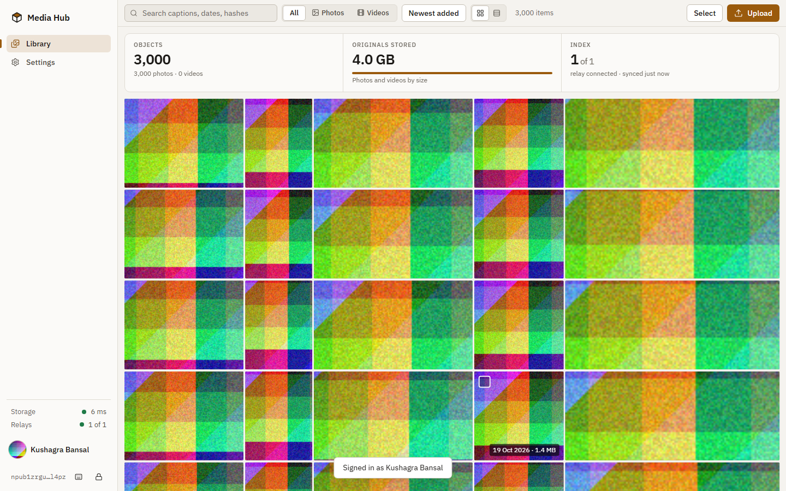

# 18. Results and discussion

**Objectives.**

| Objective | Result |
| --- | --- |
| 1. Key pair authentication; key never sent | Met. Verified by tests and a browser check of storage and requests |
| 2. Server-computed SHA-256 | Met. Mismatches are rejected and nothing is stored |
| 3. One copy of identical bytes, also concurrently | Met. 24 parallel identical uploads leave one file; benchmark scenarios leave exactly the distinct files |
| 4. No file bytes on relays | Met. The browser test checks event sizes and contents |
| 5. Thumbnails first, originals on demand | Met. No original is requested while browsing; thumbnails are at most 512 px |
| 6. Honest degraded states | Met for relay and server outages; offline browser mode shows its own banner but was not tested with the network disabled |
| 7. Keyboard, responsive, accessible | Met within the checks listed; no assistive-technology user testing was done |

**What the measurements say.** On loopback the server handled 50 MB in a few hundred milliseconds, so storage and hashing are not the bottleneck at this scale. Parallel uploads reduce total time up to about two workers and then stop helping on this machine. The expensive operation is not on the server: it is verifying signatures when a large library is fetched from a relay for the first time. Skipping events that are already known makes later refreshes cheap: a 5 000-event library took 7.2 s to fetch cold and 81 ms to refresh when every event was cached (section 17.5). In Chrome the 3 000-event library was fetched, verified and laid out in 1.7 s; reopening it from the device cache with the relay down took 0.66 s. Rendering cost does not depend on library size: with 3 000 items the page held 50 tiles at rest and at most 75 while scrolling the whole library, about 300 elements in total. Scrolling to the end requested 2 950 distinct thumbnails and no original; opening an item requested its original and, by prefetch, the next one when that is under 6 MB.

**What was learned about the protocols.** Reading the specifications matters: the NIP-98 and BUD-11 confusion in the prototype made the server incompatible with every other client. Third-party library behaviour matters as well: three of the defects fixed in this work came from assumptions about nostr-tools and go-nostr that did not hold.

**Differences from the first paper.** The paper intended to compare deduplication ratio, upload latency and gallery load time against a centralised baseline. No centralised service was measured, so that comparison is absent. The paper described relays as carrying "a web link pointing back to the user's home server"; this was implemented as the NIP-94 `url` tag, and the interface states that the link is not secret.

# 19. Limitations and future scope

**Limitations.**

* Containers, Caddy and HTTPS are untested (section 15).
* Files are not encrypted. The server operator can read them, and a file URL is readable by anyone who has it.
* Metadata on public relays is public. The index depends on relays that the user must choose and, for privacy, run.
* One identity per library. There are no shared albums, no per-file links and no quotas beyond an allow-list.
* The race detector, other browsers, MP4 and MOV previews and large files were not tested.
* Benchmarks are from one machine over loopback and say nothing about network conditions.
* The relay for development is not hardened and is not intended for production.

**Future work.** Per-file encryption with a key derived from the identity (which would give up cross-user deduplication), signed and expiring share links, a production relay in the Compose file, resumable uploads for very large videos, server-side thumbnails for files uploaded by other Blossom clients, and an independent security review.

# 20. Conclusion

The project set out to show that a personal media library can be built from a signed identity, a content-addressed file store and a relay index. The rewritten system does this: a user can create a key, upload photos and videos, see them as thumbnails from any browser that can reach the relays and the server, open the originals, download them with their hashes verified, and delete them, and the files and events involved are the ones the specifications describe. Duplicate files are stored once, including under concurrent upload. When a relay or the server stops answering, the interface shows what still works and what does not.

The work also found where the design is weak: it protects against a password database leak and a hosted provider reading files by default, but it does not hide metadata on public relays, does not encrypt files, and leaves the first load of a large library dependent on signature verification speed. These are stated in the interface and in the documentation instead of being left for users to discover.

# 21. References

1. Nostr Implementation Possibilities (NIPs). NIP-01 basic protocol, NIP-07 `window.nostr`, NIP-09 event deletion, NIP-19 bech32 encodings, NIP-40 expiration, NIP-49 private key encryption, NIP-94 file metadata, NIP-98 HTTP auth. <https://github.com/nostr-protocol/nips>
2. Blossom: Blobs Stored Simply on Mediaservers. BUD-01, BUD-02, BUD-06, BUD-11, BUD-12 (draft specifications, read on 19 October 2026). <https://github.com/hzrd149/blossom>
3. P. Wuille, J. Nick, T. Ruffing. BIP-340: Schnorr Signatures for secp256k1. <https://github.com/bitcoin/bips/blob/master/bip-0340.mediawiki>
4. National Institute of Standards and Technology. FIPS 180-4: Secure Hash Standard (SHS), 2015. doi:10.6028/NIST.FIPS.180-4
5. J. Benet. IPFS - Content Addressed, Versioned, P2P File System. arXiv:1407.3561, 2014.
6. BlurHash. <https://blurha.sh>
7. R. Fielding, Y. Lafon, J. Reschke. RFC 7233: Hypertext Transfer Protocol (HTTP/1.1): Range Requests, 2014.
8. Caddy documentation. <https://caddyserver.com/docs/>
9. W3C. Web Content Accessibility Guidelines (WCAG) 2.1, 2018. <https://www.w3.org/TR/WCAG21/>
10. Nextcloud, <https://nextcloud.com>; PhotoPrism, <https://www.photoprism.app> (product sites, consulted for the description of self-hosted alternatives).
11. SQLite. Write-Ahead Logging. <https://www.sqlite.org/wal.html>
12. C. Percival, S. Josefsson. RFC 7914: The scrypt Password-Based Key Derivation Function, 2016.

# Appendix A. Setup

See `README.md` and `docs/DEPLOYMENT.md`. Local run:

```powershell
cd backend
go build -o ..\.run\server.exe .\cmd\server
$env:DATA_DIR = "..\.run\data"; $env:PORT = "8787"; $env:BASE_URL = "http://localhost:8787"
..\.run\server.exe
```

```powershell
cd frontend
npm ci
node tools/dev-relay/relay.mjs --port 7777 --persist ..\.run\relay.jsonl
npm run dev
```

# Appendix B. Storage server API

| Method and path | Authorisation | Purpose |
| --- | --- | --- |
| `GET /<sha256>[.ext]`, `HEAD` | none | Blob bytes and headers, range requests |
| `PUT /upload` | `upload` token with `x` | Store a blob; 201 new, 200 existing |
| `HEAD /upload` | `upload` token with `x` | Pre-flight |
| `DELETE /<sha256>` | `delete` token with `x` | Remove the caller's ownership; remove the file when last |
| `GET /list/<pubkey>` | `list` token, owner only | The caller's blobs, newest first, with `cursor` and `limit` |
| `GET /info`, `GET /health` | none | Description and limits; liveness |

Full details are in `docs/API.md`.

# Appendix C. Event schema

NIP-94 kind 1063 tags written by the application: `url`, `m`, `x`, `ox`, `size`, `dim`, `blurhash`, `thumb` (`url`, `sha256`), plus the extension tags `smh-taken` and `smh-duration`. Deletions are NIP-09 kind 5 events with `e` and `k` tags. See `docs/EVENT_SCHEMA.md`.

# Appendix D. Test commands

```powershell
cd backend;  go vet ./...; go test ./...
cd frontend; npm run format:check; npm run lint; npm run typecheck; npm test
cd frontend; npm run build; npx playwright test
cd frontend; npx tsx ..\scripts\benchmarks\dedup.ts
cd frontend; npx tsx ..\scripts\benchmarks\upload.ts
cd frontend; npx tsx ..\scripts\benchmarks\relay.ts
cd frontend; npx playwright test e2e/gallery.spec.ts
python scripts\benchmarks\charts.py
cd frontend; npx tsx ..\scripts\report\diagrams.ts; npx tsx ..\scripts\report\build.ts
```

# Appendix E. Source tree

```
backend/          Go storage server (cmd/server, internal/{auth,config,db,media,server,store})
frontend/         React client (src/{lib,stores,components,pages,styles}), tools/dev-relay, tests, e2e
deploy/Caddyfile  Proxy and static hosting
docs/             Audit, plan, architecture, API, events, deployment, testing, security, benchmarks
scripts/          Benchmarks and report generation
reports/          This report in Markdown, Word and PDF
```
